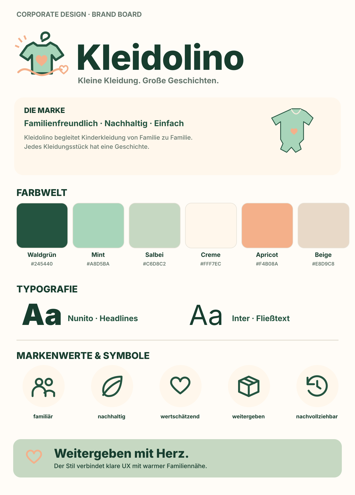
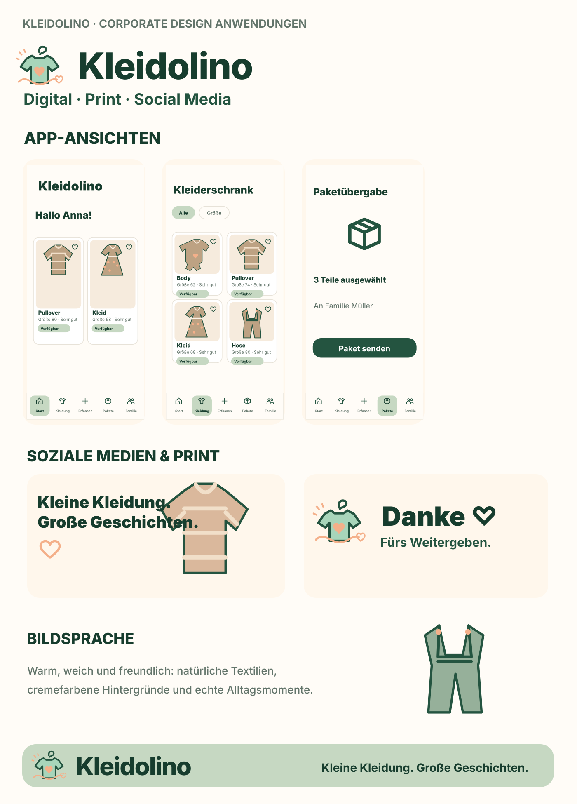

# Kleidolino · Corporate Design

**Kleine Kleidung. Große Geschichten.**

Das Corporate Design für **Kleidolino**, die familienorientierte Web-App zum Erfassen, Verwalten, Weitergeben und Nachverfolgen von Baby- und Kinderkleidung.

> Status: Designsystem und Markenassets. Diese Dateien ändern das Branding der laufenden Next.js-Anwendung nicht automatisch. Sie sind die freigegebene visuelle Grundlage für die spätere Umsetzung.

## Brand Boards

| Überblick | Anwendungen |
|---|---|
|  |  |

Die Boards in `assets/boards/` sind **vollständig bearbeitbare SVG-Neuzeichnungen** des besprochenen Corporate-Design-Konzepts. Kein Screenshot der laufenden Anwendung.

## Sofort einsetzbare Assets

- **Primärlogo:** [Horizontal](assets/logos/primary-horizontal.svg), [Gestapelt](assets/logos/stacked.svg), [Symbol](assets/logos/symbol.svg)
- **App-Icon:** [Hell](assets/logos/app-icon.svg), [Dunkel](assets/logos/app-icon-green.svg)
- **App-Mockups:** [Startseite](assets/mockups/mobile-home.svg), [Kleiderschrank](assets/mockups/mobile-wardrobe.svg), [Paketübergabe](assets/mockups/mobile-package.svg), [Lebenslauf](assets/mockups/mobile-timeline.svg)
- **Social Media:** [Quadrat](assets/social/instagram-post.svg), [Story](assets/social/instagram-story.svg), [Social Preview](assets/social/share-og-1200x630.svg)
- **Print:** [Kleidungsetikett](assets/print/clothing-tag-60x100mm.svg), [Dankeskarte](assets/print/thank-you-card-a6.svg), [Sticker](assets/print/sticker-round-60mm.svg), [Versandlabel](assets/print/shipping-label-100x150mm.svg)
- **Weitere Dateien:** Icons, Pattern, Illustrationen, UI-Elemente und Werbe-Hero unter `assets/`.

### Anleitungen

1. [BRAND_GUIDE.md](BRAND_GUIDE.md): Markenidentität, Verwendungsregeln, Farbsystem, Typografie, Bildsprache und Tonalität.
2. [ASSET_CATALOG.md](ASSET_CATALOG.md): Vollständiger Index aller 47 SVG-Dateien.
3. [WEB_IMPLEMENTATION.md](WEB_IMPLEMENTATION.md): Konkrete Next.js-Integration, Komponenten und Umsetzungsschritte.
4. [DESIGN_TOKENS.json](DESIGN_TOKENS.json) / [tokens.css](tokens.css): Farb-, Schrift- und UI-Werte als importierbare Quellen.
5. [IMAGE_GUIDELINES.md](IMAGE_GUIDELINES.md): Regeln für Fotos, Social Media und Bildverarbeitung.
6. [tools/render_assets.py](tools/render_assets.py): Erzeugt PNG- und WebP-Varianten der SVGs.

## Dateistruktur

```text
docs/corporate-design/
  README.md
  BRAND_GUIDE.md
  ASSET_CATALOG.md
  WEB_IMPLEMENTATION.md
  IMAGE_GUIDELINES.md
  DESIGN_TOKENS.json
  tokens.css
  assets/
    logos/         Logo-Familie, App-Icon
    icons/         Symbole
    patterns/      Wiederkehrende Markenmotive
    illustrations/ Dekorative Illustrationen
    ui/            UI-Komponentenbeispiele
    mockups/       Vier mobile Screens, Website-Hero
    social/        Social-Templates
    print/         Druckvorlagen
    boards/        Zwei Corporate-Design-Übersichten
  raster/          PNG/WebP (automatisch generiert)
  tools/           Rasterisierung
```

## Ausgabeformate

- **SVG**: editierbar, skalierbar, bevorzugt für Logos, Illustrationen und Druckvorlagen.
- **PNG**: kompatibles Rasterformat z. B. für Dokumente und Social Media.
- **WebP**: komprimierte Vorschau oder Web-Einsatz.
- Die PNG-/WebP-Dateien werden mit GitHub Actions aus den SVG-Quelldateien erstellt. Manuell per `python docs/corporate-design/tools/render_assets.py` nach Installation der Abhängigkeiten.

## Technische Hinweise

- Verfügbare Schriftfamilien sind **Nunito** (Headlines) und **Inter** (Body); die SVGs nutzen Font-Fallbacks und enthalten absichtlich **keine Fontdateien**.
- SVGs enthalten für Social Media und App-Mockups **eigene Vektorillustrationen**, keine Stock-Fotografien und keine realen personenbezogenen Daten.
- Für Druckproduktion: RGB-SVG vor finaler Druckfreigabe nach CMYK/ICC konvertieren, 3 mm Beschnitt bei Bedarf hinzufügen und Andruck prüfen.
- Die aktuell gezeigten Printassets sind Gestaltungsvorlagen, **keine frankierten Versandlabels**.
- Dieses Kit ist originär für Kleidolino erstellt; die Namens- und Markenrechtsprüfung erfolgt unabhängig davon.
- **Nicht in Git committen:** `.env`, Zugangsdaten, private Foto-Uploads.
